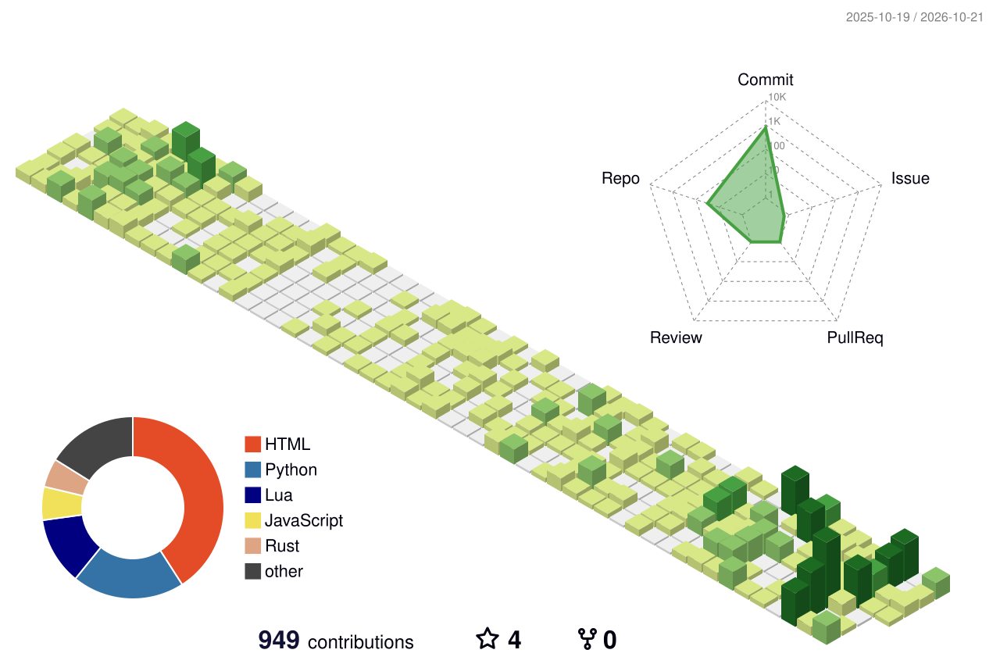

# 王延泽 · Yanze Wang

> **数学博士生**（双有理几何）· **AI for Math** · Arch Linux + Neovim · Rust / C TUI
> _Ph.D. student in mathematics (birational geometry) · AI4Math · Arch Linux + Neovim · Rust / C TUIs_

博士研究生 @ 中国科学院数学与系统科学研究院（AMSS, UCAS），方向为**双有理几何**：极小模型纲领、Sarkisov 纲领与代数可积叶层化。同时实践 **AI4Math**——Lean 4 形式化、数学专用模型训练，以及 AI 辅助研究工作流（harness）。  
_Ph.D. student at AMSS, UCAS. Research: birational geometry — the minimal model program, the Sarkisov program, and algebraically integrable foliations. Also into AI4Math: Lean 4 formalization, math-specialized model training, and AI research harnesses._

---

## 📈 贡献 · Contributions

---

## 🧠 AI · AI4Math

| 项目                                                          | 简介 · Description                                                                                           | 技术             |
| ------------------------------------------------------------- | ------------------------------------------------------------------------------------------------------------ | ---------------- |
| [**ARnDlm**](https://github.com/HiraethEcho/ARnDlm)           | 同 tokenizer / 数据 / 环境下对照 **AR 语言模型**与**扩散语言模型（DLM）** _AR vs. diffusion language models_ | Python           |
| [**micro-agent**](https://github.com/HiraethEcho/micro-agent) | 基于 mini-SWE-agent 的极简编码智能体：bash-only、ask/auto/yolo 三模式 _Minimal bash-only coding agent_       | Python           |
| [**lean-toric**](https://github.com/HiraethEcho/lean-toric)   | 用 Lean 4 形式化部分Toric Varieties 结果 _Lean 4 formalization of toric varieties_                           | Lean 4 · mathlib |
| [**Rethlas**](https://github.com/HiraethEcho/Rethlas)         | Fork 和个人化适配，添加 Pi 等支持                                                                            | MCP              |

## 🌊 Vibe Coding

_Vibe coding 的小项目_

| 项目                                                    | 简介 · Description                                                                 | 技术                    |
| ------------------------------------------------------- | ---------------------------------------------------------------------------------- | ----------------------- |
| [**calman**](https://github.com/HiraethEcho/calman)     | 终端任务与事件管理器，JSONL / ICS 存储、兼容 CalDAV _CLI/TUI task & event manager_ | Rust · ratatui          |
| [**markerss**](https://github.com/HiraethEcho/markerss) | 终端 RSS 阅读器，可把文章导出为 Markdown _TUI RSS reader with Markdown export_     | Rust · Go · C++         |
| [**mumble**](https://github.com/HiraethEcho/mumble)     | 极简云端留言板，可嵌入任意页面 _Serverless, embeddable message board_              | Cloudflare Workers · D1 |
| [**lichtung**](https://github.com/HiraethEcho/lichtung) | 支撑我全部个人站点的 Hugo 主题 _Hugo theme behind my sites_                        | Hugo · SCSS             |

## 🧰 工作环境 · Environment

_我的开发环境，以及使用 AI 工具的相关仓库_

| 项目                                                    | 简介 · Description                                                                                                  | 技术        |
| ------------------------------------------------------- | ------------------------------------------------------------------------------------------------------------------- | ----------- |
| [**AiKit**](https://github.com/HiraethEcho/AiKit)       | AI 智能体工具集合：agents / skills / 人设 / 部署脚本 / [pi](https://pi.dev)插件等 _Agent toolkit for coding agents_ | Python · TS |
| [**nvim**](https://github.com/HiraethEcho/nvim)         | Neovim 配置（LaTeX / Markdown 为主） _My Neovim config_                                                             | Lua         |
| [**dotfiles**](https://github.com/HiraethEcho/dotfiles) | Shell / 系统配置 _Dotfiles_                                                                                         | Shell       |
| [**suckless**](https://github.com/HiraethEcho/suckless) | dwm, dwmblocks etc 个性化分支 _Personal dwm forks_                                                                  | C           |

## ✍️ 最近写作 · Latest Writing

- [**docs**](https://github.com/HiraethEcho/docs) — 旧技术文档与笔记，
- 项目开发文档笔记 [docs.keinmal.top](https://docs.keinmal.top)
- 个人杂文站站点 [memex.keinmal.top](https://memex.keinmal.top)

<!-- BLOG-POST-LIST:START -->
<!-- BLOG-POST-LIST:END -->

## 🛠 工具 · Stack

`C` `C++` `Rust` `Python` `Lua` `JavaScript / TypeScript` `LaTeX`
**环境**：Arch Linux（Niri / dwm）· Kitty/foot · Neovim · Herdr · Pi/OpenCode/Codex
**AI**：pi · PyTorch · Lean 4 · agent harness

---

> [关于我的更多 · More about me](https://keinmal.top/about)
